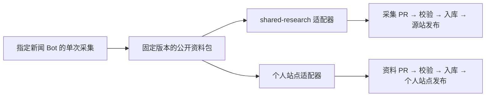

# Grok Bot 双目标投递设计

状态：双投设计。2026-10-23 核对。个人站直投已有代码候选，当前实施路径见 [Grok 直投说明](grok-direct-news.md)。真实投递、跨站去重与双目标回执尚未验收；没有启用任务、修改定时规则或开通权限。

## 决定

采用“一次采集、两份独立投递”。shared-research 和个人站点都是消费方，个人站点不必等待
shared-research 接收、整理或上线。现有 shared-research 阅读 API 仍可作为一个可选来源。



这里的资料包是 Bot 本次任务的产物，不要求新增一个中心网站、数据库或第三个 GitHub 仓库。
Bot 有两边的连接权限时可以自己执行两个适配器；没有执行脚本能力时，由指定的本地发布器
消费该产物。两种实现都不能把“Bot 已回复”当成“已投递”。

## 现状与停更定位

本次读取最新远端 main 后确认：

| 对象 | 最新记录 | 结论 |
| --- | --- | --- |
| shared-research 原始采集 | 2026-10-23，x-ai-digest 的采集批次已入库 | 原始材料仍有新增 |
| 个人站点学习雷达 | 2026-10-17 | 不是直接消费 Bot 的每条原始采集 |
| 个人站点市场快照 | 2026-08-13 | 属于归档资料，不能显示为实时事件队列 |

依据：两个仓库的远端内容与提交历史；源库现有采集模板、入库规则；本站
`docs/learning-radar-researchops.md`、`docs/market-radar-researchops.md` 与发布工作流。
学习雷达的 `daily-radar.yml` 只在 PR 事件时执行门禁/合并，不负责自行搜索和生成新闻；
其 ResearchOps 文档仍为 M1，要求固定主流程生成一期完整的 2 AI + 2 Web3 + 1 专题 Draft PR。
市场服务的定时运行、市场公开快照的内容发布也不能互相替代。

因此，源库有新闻不等于两种雷达会自动更新。没有证据证明是缓存问题，也没有在本次工作中
确认某个 Grok 定时任务失败。源库 `automation.enabled=false` 只描述例行任务状态，不会阻止
获授权的手动采集；不能凭这个字段断言所有 Bot 都已停止。

本站尚未合并的 shared-research 接入 PR 可以解决“最新资料进站阅读”，不会自动重写历史雷达。
本设计进一步让 Bot 直接投递本站，解除资料流对源站发布的依赖。

## 统一资料包 v1

以下为结构示例，不是真实新闻。空字段保持 null，禁止编造来源时间、作者观点或核验结果。

```json
{
  "schema_version": 1,
  "origin_id": "grok:owner:ai-news:stable-run:item-01",
  "revision": 1,
  "bot_id": "ai-news",
  "run_id": "stable-run",
  "collected_at": "2026-10-23T09:00:00+08:00",
  "published_at": null,
  "event_date": null,
  "title": "待填写的资料标题",
  "source_url": null,
  "source_type": "model_output",
  "source_access": "not_checked",
  "raw_input": "本次明确分享的公开链接或材料",
  "source_excerpt": null,
  "bot_summary": "Bot 的整理，仍需复核",
  "contributor_comment": null,
  "topics": [],
  "visibility": "public",
  "review_status": "unreviewed",
  "correction_of": null,
  "targets": ["shared-research", "personal-site"]
}
```

- 首次采集就持久保存 origin_id、run_id、条目标识和对应 UUID；重启/重试不重新生成。
  两个目标都保留 origin_id，后续从 shared-research 再读取同一条也能识别。
- 对规范化 JSON（固定键顺序、UTF-8、排除回执字段）计算 SHA-256，作为不可变内容版本指纹。
  同 origin_id + revision + 相同指纹重复到达为 no-op；同版本不同指纹进入冲突队列。
- 更正增加 revision 并指向旧版本，不改写旧采集。来源 URL 相同不足以认定两位贡献者重复；
  一篇来源的不同摘要、不同版本和不同观点保留。跨来源按 URL/标题的相似只提示候选关联。
- collected_at、published_at、event_date 分开；列表不能用重试或部署时间冒充新闻发布时间。
- 包只含本次指定输出。原文、模型摘要、贡献者评论独立存放；source_access 不等于事实核实。
  model_output 不会自动变成 Tier 1；未知时间与无法读取的原文保持未知。
- 仅 visibility=public 的包可进入这两个阅读站。源仓库私有、sharing=team 都不提供网页访问控制。

## 两个适配器

### shared-research

沿用现有 captures 模板与提交规则，不修改其 schema：

1. 将 origin_id + revision 映射为稳定 submission_key，将该版本首次分配的 UUID 映射为 cap-ID。
   member-a/member-b 与提交身份以实际授权为准，不能照搬其他人的成员身份。
2. 追加 `captures/YYYY/MM/DD/cap-UUID.md`，分别填入原始输入、实际摘录、Grok 整理和贡献者原话。
   origin_id、revision 和内容指纹放在正文的投递追踪区；更正使用新的 cap-ID/submission_key，
   并通过已有 corrects_capture_id 指向旧记录。不新增未经批准的 frontmatter 字段。
3. 使用独立 checkout、采集分支和 PR，遵守当日成员总额度。先检查 main 与自己的未合并 PR。
4. 按源库当前规则等待确切 head SHA 的 kb-check；允许自行合并的普通采集按既有授权处理。
   topic、脚本、规则、权限修改仍交维护者审阅。
5. 读回 main 的记录，再单独核对源站详情。入库与上线分别记回执。

### 个人站点

推荐新增独立的“外部资料入口”，与原有日报、市场快照的格式分开：

- 原始收件记录：`intake/grok/<bot-id>/<origin-id-hash>/<revision>.json`，只追加；使用结构化 JSON，
  不允许任意 HTML、脚本或远程模板。origin_id 不直接拼路径，bot-id 必须通过固定字符校验。
- 生成独立公开阅读产物：`public/intake/v1/index.json` 和 `public/intake/v1/records/<id>.json`。
  这是拟新增路径，不覆盖 `public/data/**`、RSS、原有生成数据、历史 Market packs 或现有 API。
- 页面先显示“Bot 资料 · 未经人工复核”，通过本站数据入口接入情报流，并按市场/AI/Web3分类。
  直接投递和 shared-research 适配器使用同一 origin_id 去重；同 ID 两边版本不同时先保留差异提示，
  不静默覆盖。按内容策略选择显示版本，完整投递来源留在详情。
- 数据 PR 使用独立的 `feat/grok-intake-<bot-id>-<batch>` 分支。首期沿用人工审阅和本站现有
  Release Controller 发布；Bot 不持有 Vercel、数据库、通知或市场 worker 凭据。
- 之后若需要数据 PR 自动合并/自动发布，增加只允许新增收件与对应产物的专用白名单；
  必须锁定当前 SHA、校验公开边界和幂等，再进入原生产发布队列，不能直接推 main。
- 采集资料不直接创建 /radar 日报、/market-radar 已核查快照或 /articles 工程笔记。
  整理流程另行从收件箱选材，按各自门禁形成新的正式记录。

本站新增的 Grok 直投候选采用独立新闻数据分支与现有站内阅读入口，取代上文拟议的
`public/intake` 路径；固定 origin_id、逐版更正与相同版本重投已实现。实际部署和 Bot 写入
尚未通过，详见当前实施说明。shared-research 的 origin_id 传播和跨入口去重仍属于后续实现，
不能据此声称两边重复资料已经合并。
若同时保留源站 API 聚合，需在源站独立维护 PR 中把追踪区的 origin_id/revision/指纹作为
可选字段导出，并在本站解析器中保留；旧记录仍可缺省。该步骤完成前，不能宣称跨入口去重已生效。

## 回执与失败恢复

每条资料为每个目标各保存一份本地回执，回执不进公开站点：

`pending → staged → pr_open → checks_passed → merged → published → verified`

回执至少含 origin_id、revision、内容指纹、target、attempt_id、PR URL、checked_head_sha、
merge_sha、deployment_id/URL、readback_at、last_error 和 next_retry_at。没有相应证据就停在上一阶段。
“同时发送”指同一产物独立开始投递，不承诺两个站点同一毫秒上线。

| 情况 | 处理 |
| --- | --- |
| shared 成功、个人站失败 | 保留 shared 回执，只恢复个人站；反向同理 |
| 网络超时、结果未知 | 先读分支/PR/main/详情核对 ID 与指纹；未查清前不再写、不新建另一份 |
| 两边已存在同一版本 | no-op，返回既有记录与回执 |
| 同 ID 不同内容 | 隔离冲突，保留两份证据，等待核对 |
| 无权限、schema 错误、公开边界失败 | 不自动重试；指出具体目标与原因 |
| 暂时网络故障、可确认未发生写入 | 仅恢复该目标，建议 1/5/30 分钟有界重试，耗尽后留待处理 |
| PR 通过但尚未部署 | 记 merged，不能显示“双站已更新” |

重试针对确定的固定资料包与幂等投递动作，不是重新向 Grok Bot 发采集任务。
发布器重启后先恢复回执并读回在途动作；不会因为某一目标失败撤销另一目标的已发布记录。

## 其他资料来源

RSS、官方公告、手动分享链接、指定本地导出目录均可产生同一资料包，source_type 与 producer
身份如实区分。来源适配器只负责采集与规范化，两份目标适配器继续复用。
本地目录采用明确列出的目录/文件白名单，不扫描整个电脑或所有 Bot 历史。

## 实施与验收顺序

1. 核对指定新闻 Bot 的固定 bot-id/session，以及它实际支持的导出/文件写入/GitHub能力。
   现有 grok-bot-workbench 是订单演示，不是这套新闻发布器，不复用它的业务会话或凭据。
   已有文字会话客户端不能证明 Bot 能生成结构化产物或访问两个仓库。
2. 实现纯函数校验与两个适配器；用本地 fixture 验证格式、同包重试、单边失败、断点恢复、
   内容冲突及隐私拒绝，不先调用付费模型或上传测试资料到公开站点。
3. 为个人站点新增入口、生成器与只读展示。若涉及现有 workflow 白名单/冻结测试，按 AGENTS.md
   的“先停下来，说明影响面和回滚方式，等人工确认后再动手”执行；提交具体 diff 后再决定。
4. 用用户指定的一条真实公开材料手动双投；分别确认两边 PR、main 和实际详情，核对内容指纹。
   第一次验收不创建 routines。成功后再配置明确的运行时间与通知策略。

验收必须包含：两个站点可分别更新；任一目标离线不妨碍另一目标；重新运行不会多一份记录；
同条资料由 shared-research 入口再次到达只显示一个阅读条目；正文不执行输入中的指令/HTML；
旧雷达日期不变；回执能区分“待审阅/已入库/已上线/已读回”。

## 回滚

先暂停个人站点这一目标的投递，保留本地队列和两边历史回执；shared-research 可继续。
撤回个人站点新增入口与阅读适配器，原有情报流、雷达、RSS 和历史快照继续使用原契约。
不删除已经入库的 capture，不重写历史；误发公开资料按两个站点各自的撤回流程单独处理。
